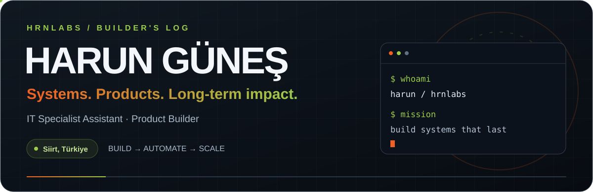
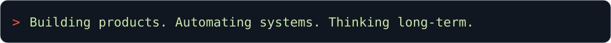
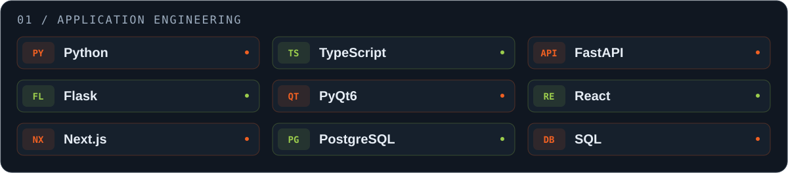
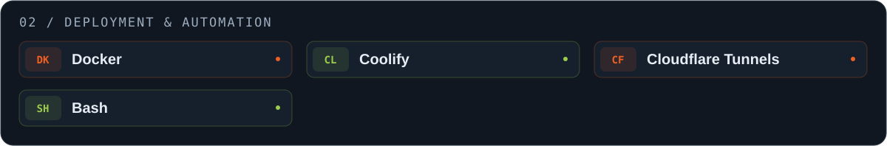
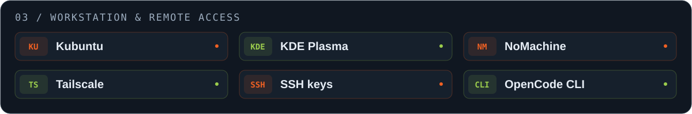
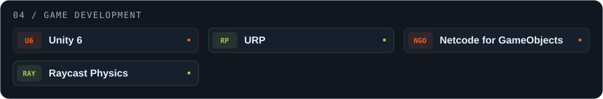
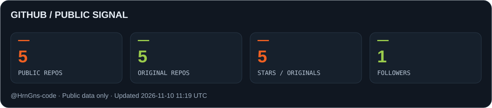
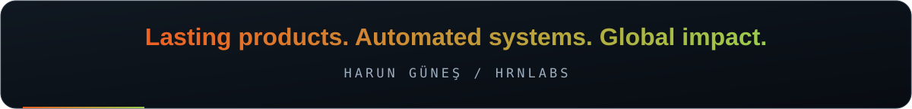

<!--
HARUN GÜNEŞ / HRNLABS PROFILE
GitHub username: HrnGns-code
Upload assets/, scripts/ and .github/ alongside this README to preserve the full design.
Project names are intentionally unlinked until verified repository or store URLs are available.
-->

<div align="center">



<br />



<br />
<br />

**IT Infrastructure &nbsp; / &nbsp; SaaS Products &nbsp; / &nbsp; Game Development &nbsp; / &nbsp; Automation**

[My GitHub](https://github.com/HrnGns-code) &nbsp; · &nbsp; [Projects](#hrnlabs) &nbsp; · &nbsp; [Tech Stack](#tech-stack) &nbsp; · &nbsp; [Setup](#profile-setup)

</div>

<br />

## ⚡ Hey, I'm Harun.

I'm an **IT Specialist Assistant** and product builder. I bring hands-on experience in enterprise infrastructure to **SaaS products, self-hosted systems, automation and multiplayer games**.

**I'm building HrnLabs with a vision of creating lasting products and systems that make a global impact.** My focus is on automating repetitive work, creating long-term value and turning ideas into sustainable products.

> **I want the systems I build to keep creating value long after the work is done.**

| What I work on | Hands-on experience |
| :--- | :--- |
| 🛡️ **Enterprise IT** | Active Directory, GPO, Exchange Online, FortiGate firewalls and endpoint security management |
| 🧩 **Products & architecture** | API development, PostgreSQL, schema-per-tenant architecture and AI-focused SaaS |
| ⚙️ **Operations & automation** | Self-hosted open-source systems, automation scripts and CLI-driven workflows |
| 🎮 **Game development** | Unity 6, URP, Netcode for GameObjects and custom raycast physics scripts |

<br />


<a name="hrnlabs"></a>

## 🚀 HrnLabs / Product showcase

### 🏁 Dash and Crash

**3D mobile arcade combat racing game · In development**

A mobile game built around speed, collisions and multiplayer combat. I'm developing it with **Unity 6 + Universal Render Pipeline**, **Netcode for GameObjects** and custom **raycast physics scripts**.

`Unity 6` `URP` `Netcode for GameObjects` `Raycast Physics`

### 🎫 B2B SaaS IT Ticketing System

**AI-focused enterprise ticketing system · In development**

A multi-tenant SaaS for managing enterprise IT requests. Built with **FastAPI**, **React** and **PostgreSQL schema-per-tenant** architecture.

`FastAPI` `React` `PostgreSQL` `Multi-tenancy`

| 🎉 VibeCheck | 🧠 BrainSprint |
| :--- | :--- |
| A party game focused on social interaction. | An online multiplayer trivia game. |
| **Google Play · August 2026** | **Google Play · September 2026** |

<!-- Add verified repository or store URLs to the project names when available. -->

<br />


<a name="tech-stack"></a>

## 🧰 My tech stack









**My everyday approach:** work from the CLI, self-host open-source tools and automate repetitive tasks with scripts. I use OpenCode through its **CLI**.

<br />

## 🛡️ Security in practice

Alongside enterprise infrastructure and endpoint security, I've worked on **internal phishing simulations and security awareness training for UlakCX**. I care about strengthening both technical systems and the people who use them.

<br />


## 📊 GitHub / Public signal



<sub>Refreshed through GitHub Actions. Stars are summed across public, non-fork repositories owned by my account. Private repositories and organization-owned repositories are excluded.</sub>

### 🐍 Contribution snake

<picture>
  <source media="(prefers-color-scheme: dark)" srcset="./assets/github-snake-dark.svg" />
  <source media="(prefers-color-scheme: light)" srcset="./assets/github-snake.svg" />
  
</picture>

<br />

<details>
<summary><b>☕ Beyond the terminal</b></summary>

<br />

- 🚶 Long walks: **20,000–35,000 steps a day**.
- 🍝 Homemade pasta, ganache-topped San Sebastian cheesecake and fruit-based desserts.
- 🎧 Turkish hip-hop, especially Norm Ender.
- 🌙 Dark fantasy worlds: *The Sandman*, *Lucifer* and *Shadowhunters*.
- 🖥️ Upgrading PC and server hardware and finding the right components for the job.

</details>

<br />

<a name="profile-setup"></a>

<details>
<summary><b>🔧 Profile setup</b></summary>

### 1. Prepare the profile repository

Use a **public repository named `HrnGns-code`**, matching your GitHub username. Place this `README.md` at its root. The GitHub profile link is already configured for **HrnGns-code**.

### 2. Upload the design files

Upload the package's `assets/`, `scripts/` and `.github/` folders, preserving their structure. The banner, typing animation and tech badges are local SVG files; uploading only the README will not include them.

```text
HrnGns-code/
├── README.md
├── assets/
│   ├── hero.svg
│   ├── typing.svg
│   ├── divider.svg
│   ├── stack-build.svg
│   ├── stack-deploy.svg
│   ├── stack-workflow.svg
│   ├── stack-games.svg
│   ├── profile-stats.svg
│   ├── github-snake.svg
│   ├── github-snake-dark.svg
│   └── footer.svg
├── scripts/
│   └── update_stats.py
└── .github/workflows/
    └── profile-visuals.yml
```

If the upload screen rejects the hidden `.github` folder, use **Add file → Create new file**, enter **`.github/workflows/profile-visuals.yml`** as the filename, paste the workflow below and commit it. GitHub will create the folders from the path.

### 3. Enable the snake and statistics

Add **`.github/workflows/profile-visuals.yml`** from the package. Enable **Settings → Actions → General → Workflow permissions → Read and write permissions**, then select **Actions → Refresh profile visuals → Run workflow**. Repository or organization policies must allow this permission.

The workflow reads the username automatically from **`github.repository_owner`**. It uses GitHub's built-in **`GITHUB_TOKEN`**; no personal access token is required. `scripts/update_stats.py` uses only the Python standard library.

Updates are scheduled daily at **03:23 UTC** and may be delayed by GitHub's scheduler. You can also run the workflow manually. Until the first successful run, the cards display setup messages rather than fabricated statistics or sample contributions.

Workflow contents:

```yaml
name: Refresh profile visuals

on:
  schedule:
    - cron: "23 3 * * *"
  workflow_dispatch:

permissions:
  contents: write

concurrency:
  group: profile-visuals
  cancel-in-progress: false

jobs:
  refresh:
    runs-on: ubuntu-latest
    timeout-minutes: 15
    steps:
      - name: Check out the profile repository
        uses: actions/checkout@fbc6f3992d24b796d5a048ff273f7fcc4a7b6c09 # v5
        with:
          ref: ${{ github.event.repository.default_branch }}

      - name: Generate real public profile statistics
        run: python3 scripts/update_stats.py
        env:
          PROFILE_USERNAME: ${{ github.repository_owner }}
          GITHUB_TOKEN: ${{ secrets.GITHUB_TOKEN }}

      - name: Generate contribution snake in both themes
        uses: Platane/snk/svg-only@d8f6715049803e982ee5ff501b6b9b7d5deeb09b # v3
        with:
          github_user_name: ${{ github.repository_owner }}
          github_token: ${{ secrets.GITHUB_TOKEN }}
          outputs: |
            assets/github-snake.svg?color_snake=%23F06022&color_dots=%23ebedf0,%23e0edc9,%23c2dc95,%239BCC4C,%236e9c2d
            assets/github-snake-dark.svg?palette=github-dark&color_snake=%23F06022&color_dots=%23161b22,%23263520,%23485f2e,%23779f3d,%239BCC4C

      - name: Commit updated visuals
        env:
          DEFAULT_BRANCH: ${{ github.event.repository.default_branch }}
        run: |
          git config user.name "github-actions[bot]"
          git config user.email "41898282+github-actions[bot]@users.noreply.github.com"
          git add assets/profile-stats.svg assets/github-snake.svg assets/github-snake-dark.svg
          if git diff --cached --quiet; then
            echo "No visual changes."
            exit 0
          fi
          git commit -m "chore: refresh profile visuals"
          git push origin "HEAD:${DEFAULT_BRANCH}"
```

The workflow updates only the three generated SVG files and commits them to the repository's default branch. If branch protection prevents direct bot commits, use a pull request flow that complies with your repository rules. No `push` trigger is used, so bot commits do not start another workflow cycle.

### 4. Final touches

- Add verified repository and Google Play URLs to the relevant project names.
- Add your HrnLabs website, email or social profiles only when you have the correct URLs.
- Brand colors are **`#F06022`** and **`#9BCC4C`** in the SVG files.
- SVG motion depends on browser animation support. The banner text and badges remain readable without motion; the typing text also appears in its image's alternative description.
- You can remove this setup section once everything is configured.

**References:** [GitHub profile README setup](https://docs.github.com/en/account-and-profile/how-tos/profile-customization/managing-your-profile-readme) · [Creating files and folders on GitHub](https://docs.github.com/en/repositories/working-with-files/managing-files/creating-new-files) · [Platane/snk](https://github.com/Platane/snk) · [GitHub users API](https://docs.github.com/en/rest/users/users#get-a-user) · [GitHub repositories API](https://docs.github.com/en/rest/repos/repos#list-repositories-for-a-user)

</details>

<br />

<div align="center">



</div>
